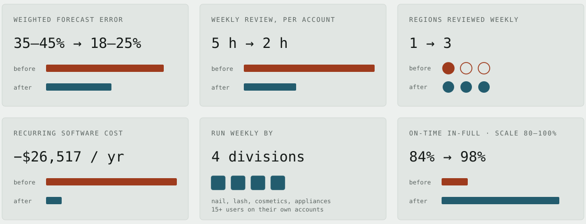
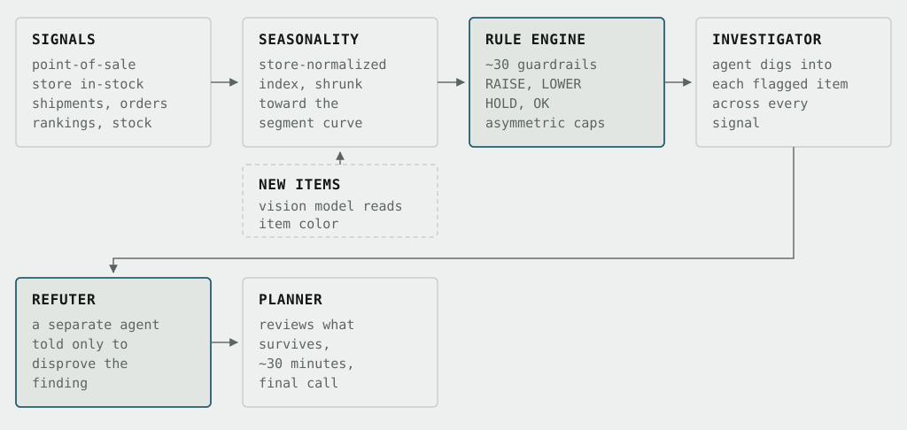
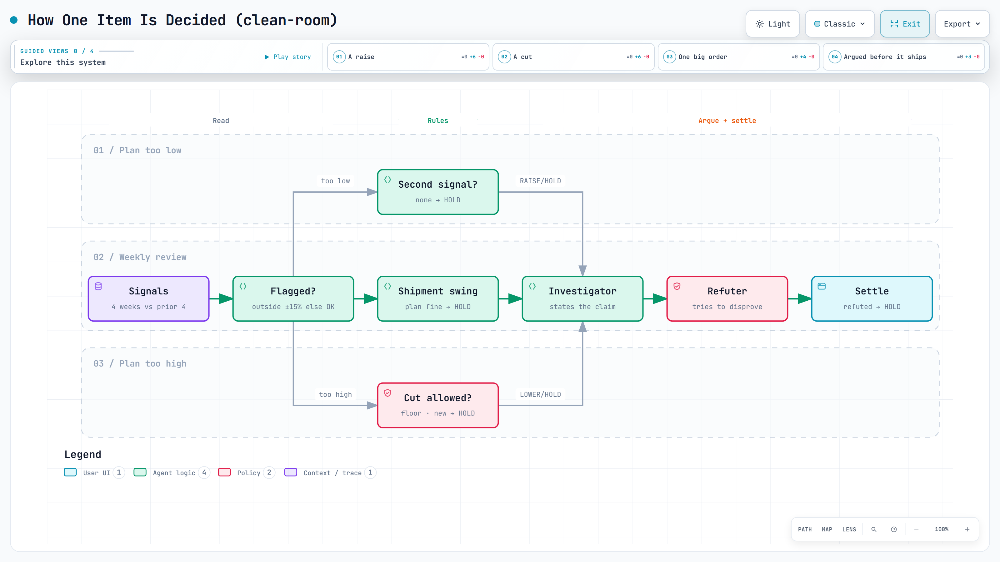
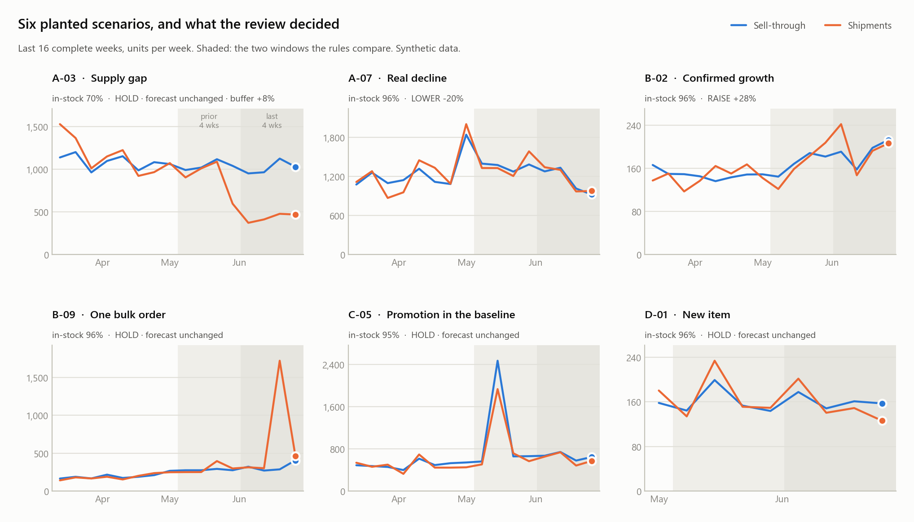
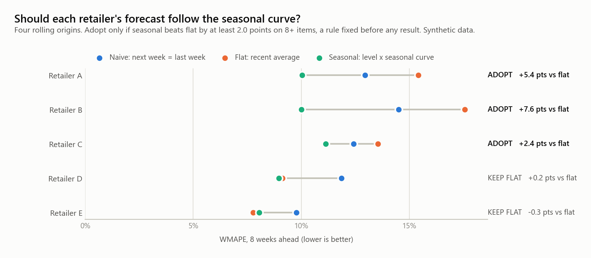
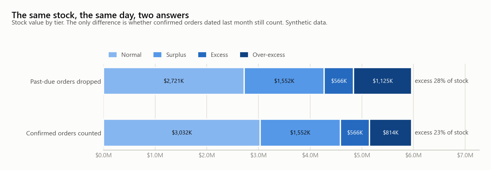
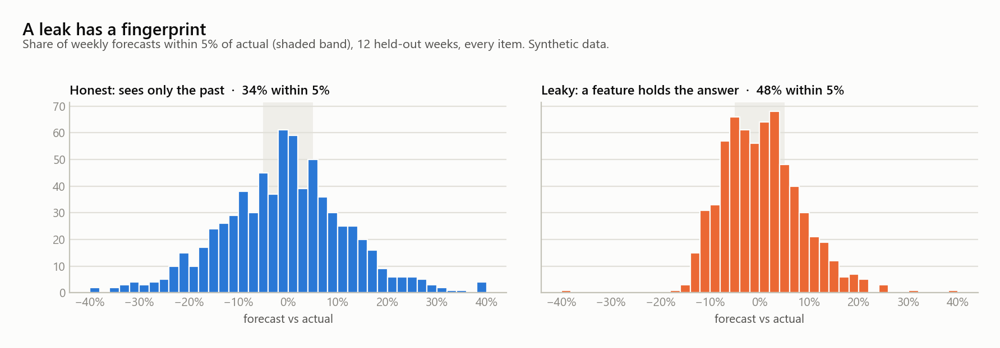

# Jay Sejun Song

**Supply chain analytics & applied AI** · CPG beauty · US / Canada / Europe

> I am a demand planner who builds the forecasting systems I plan with.

I have planned demand at Kiss Beauty Group since January 2024. I started with six US and UK accounts, and today I cover 20+ retail accounts across the US, Canada and Europe, about 1,400 nail SKUs. I co-built the agentic AI planning system we run on now. My part was the agent architecture, the business rules and guardrails, the data integration, and the MCP server the agents run on. In backtests it nearly halved weighted forecast error, and since it went live in January 2026 the share of sales orders backordered for planning reasons is down 36%. It placed third of 24 teams in the company-wide AI Awards 2026.

**Email:** [jaysejunsong@gmail.com](mailto:jaysejunsong@gmail.com) · **LinkedIn:** [jay-sejun-song](https://www.linkedin.com/in/jay-sejun-song)

---

## Two ways in

| | |
|---|---|
| **Read the work** → [`docs/`](docs/) | 19 write-ups. Each leads with the outcome and states the definition behind every number. Start with [the forecasting system](docs/work/forecasting-system.md), then [what the weekly job became](docs/work/exception-based-planning.md). |
| **Run the system** → [`system/`](system/) | A clean-room rebuild on synthetic data: rule engine, review agents, an MCP tool server, six Jupyter notebooks, 31 tests. |

Also: [how I decide a number is real](docs/how-i-work.md) · [about](docs/about.md) · [what changed and when](docs/changes.md)

## Proof

<picture>
  <source media="(prefers-color-scheme: dark)" srcset="docs/images/proof-dark.svg">
  
</picture>

<details>
<summary><b>How each number was measured</b></summary>

| Result | Value | Definition, window and caveat |
|---|---|---|
| Weighted forecast error | 35–45% → 18–25% | WMAPE, volume-weighted by shipment units · Σ\|actual − forecast\| ÷ Σ\|actual\| · eight major domestic accounts · existing items · 2026 Q1, validated on a six-month rolling backtest · the range is the spread across retailers, not uncertainty |
| Weekly forecast review | 5 h → 2 h per account | ≈60% less time per account review · ≈3,100 hrs/yr of capacity across the team (≈1.5 FTE): 3 hours a week × 20 accounts × 52 weeks · an estimate of what a weekly review of every account would have cost, since Canada and Europe were reviewed monthly or skipped before |
| Coverage | 1 region → 3, weekly | the US, Canada and Europe · review throughput ≈4× (monthly → weekly), filling a capacity gap without a new hire |
| Recurring software cost | −$26,517 / yr | 88% lower: a third-party planning platform's $30,117/yr license, now retired, less $3,600/yr for the in-house system · a realized saving |
| Planning backorders | −36% | share of sales orders backordered for planning or procurement reasons, January to October 2025 against the same months of 2026 · the system went live in January 2026 · procurement codes sit in the same measure, so I do not claim all of the drop |
| Adoption | 4 divisions | nail, lash, cosmetics and appliances · 15+ purchasing and supply-chain users run it weekly on their own accounts · each team set up on its own data, trained, and running it without me |
| On-time in-full | 84% → 98% | one retailer's own vendor scorecard, within six months · late and short penalties down 31% year over year through the first quarter · allocation across 20+ retail accounts since Q3 2025 · unit fill rate was already about 99%, so the gain came from allocation, not extra inventory · the same approach took a second major retailer's fill rate from the mid-80s to the high-90s, held for eight months · read next to [excess and aging stock](docs/work/inventory-health-reporting.md) |

</details>

## How the system works

<picture>
  <source media="(prefers-color-scheme: dark)" srcset="docs/images/system-flow-dark.svg">
  
</picture>

Cutting and raising follow deliberately different rules, because the two ways to be wrong do not cost the same. An agent investigates what the rules flag; a second agent is told only to disprove it; a refuted change does not ship. [The full write-up](docs/work/forecasting-system.md) · [how I decide a number is real](docs/how-i-work.md)

**Interactive diagrams** of the clean-room version: click through guided views, trace routes, search nodes. The images are still frames; each diagram is one self-contained HTML file you can download and open in a browser.

### The clean-room system map

<!-- Restore when the site is published: [Open interactive](https://yss2333.github.io/Jay-supply-chain-ai-portfolio/diagrams/system-map.html) · -->[HTML source](docs/diagrams/system-map.html)

<picture><source media="(prefers-color-scheme: dark)" srcset="docs/images/diagrams/system-map-dark.png"></picture>

### How one item is decided

<!-- Restore when the site is published: [Open interactive](https://yss2333.github.io/Jay-supply-chain-ai-portfolio/diagrams/review-decision.html) · -->[HTML source](docs/diagrams/review-decision.html)

<picture><source media="(prefers-color-scheme: dark)" srcset="docs/images/diagrams/review-decision-dark.png"></picture>

## The work

**Forecasting, and the system that runs it**

- [The forecasting system](docs/work/forecasting-system.md) — architecture, asymmetric rules, agent roles, results
- [What the weekly job became](docs/work/exception-based-planning.md) — rules settle what they can, a person takes the rest
- [Allocation when supply is short](docs/work/allocation.md) — on-time-in-full 84% → 98% on the retailer's own scorecard
- [Handing the system to teams that are not mine](docs/work/handover-to-other-teams.md) — four product divisions, 15+ people, weekly, without me
- [Forecasting new products before they sell](docs/work/new-product-introduction.md) — the cross-retailer forecast that supported a pitch securing a second national retailer; 178 new items across 380+ launches
- [Rebuilding the review rules](docs/work/fc-review-overhaul.md) · [Fix the data before you judge the item](docs/work/data-integrity-review.md)
- [Measuring forecast accuracy at all](docs/work/forecast-accuracy-measurement.md) · [From R to Python to a forecast engine](docs/work/forecast-automation-engine.md)

**Customers, orders and service level**

- [How much of a customer's plan to trust](docs/work/supply-plan-vs-orders.md)
- [Service level for a grocery wholesaler](docs/work/wholesale-service-level.md) · [Back-orders at two retailers, caused by a third](docs/work/shared-stock-pool.md)
- [Forecast, orders and back-orders in one tracker](docs/work/fc-order-backorder-tracker.md) · [Order trend and in-stock dashboard](docs/work/order-trend-dashboard.md)

**Inventory, procurement and data**

- [Excess and aging inventory, five plants](docs/work/inventory-health-reporting.md)
- [Stock availability checks, automated](docs/work/stock-check-automation.md) · [Freight routing from days of coverage](docs/work/shipping-route-automation.md)
- [Dashboards for vendors, retailers and the warehouse](docs/work/dashboards.md)
- [From SAP to Snowflake](docs/work/data-platform.md)

**Earlier work (2022–2023)** — [Boeing case competition, stock price forecasting, labor market research](docs/archive/2023/README.md)

[All write-ups, with results →](docs/work/README.md)

## What the clean-room version produces

Everything below runs on synthetic data, from [`system/`](system/README.md). Same design as production, none of its data.

| | |
|---|---|
|  |  |
| **Six planted scenarios** — a supply gap, a promotion in the baseline, a bulk order, a new item. Each tests one rule | **A pre-registered backtest** — the seasonal curve is adopted only where it beats flat by the margin fixed in advance |
|  |  |
| **The same stock, two answers** — what one date rule does to reported excess | **A leak has a fingerprint** — how often a forecast lands within 5% of actual |

## Run the system

```bash
cd system && pip install -r requirements.txt
python -m forecast_review                  # weekly review, a trace for every flagged item
python -m forecast_review backtest         # pre-registered backtest against a naive baseline
python -m unittest discover -s tests -t .  # 31 tests
jupyter lab notebooks/                     # six notebooks, one per write-up
```

## What is in this repository

```
.
├── docs/                  the portfolio site (GitHub Pages: main / docs)
│   ├── index.html             home
│   ├── work/                  19 write-ups, one per project
│   ├── how-i-work.md          validation, metrics, the decision log
│   ├── diagrams/              seven interactive diagrams, one per key write-up
│   ├── images/ · css/         charts, diagram stills, the stylesheet
│   ├── about.md · changes.md
│   └── archive/2023/          earlier statistics and analytics projects
└── system/                the clean-room forecast review, on synthetic data
    ├── forecast_review/       signals, seasonality, rules, agents, validation
    ├── supply_ops/            excess and aging, plan horizons, coverage, leakage
    ├── notebooks/             six Jupyter notebooks
    ├── mcp_server.py          thirteen tools for Claude Code
    └── tests/                 31 tests
```

## About confidentiality

This repository describes work done for my employer in terms of structure, methods and decisions. Accounts are named where the work being described is my own planning, and left as a type ("a national drugstore chain") where the number belongs to the customer. Raw order and sales data, customer contract terms, system credentials and internal identifiers stay out. The numbers that appear are my own results, each shown with the definition it was measured under. No code or data from my employer is included: `system/` was written from scratch for this repository, on generated data, with illustrative parameters.
