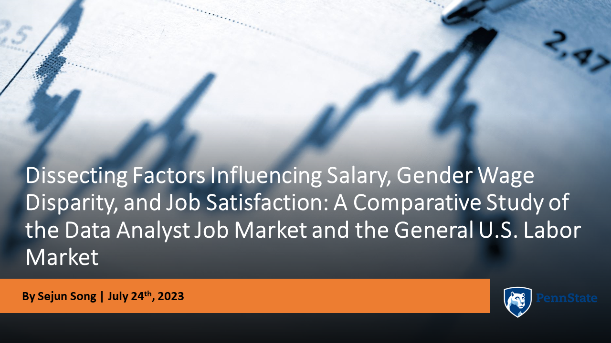
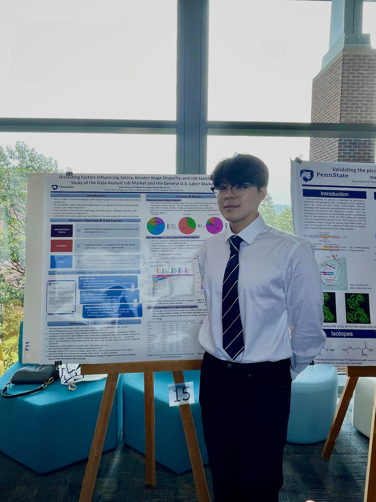

# Earlier work, 2022–2023

The projects from Penn State and 2023 that still shape how I work, most relevant first, then a short list of coursework from the same period.

---

## Boeing case competition

**Penn State × Boeing, fall 2022.** A team competition: working as consultants on a contract problem, presented to a panel of Boeing judges.

### The brief

Boeing expected a contract from the German Ministry of Defense, worth over $6 billion, for 60 Chinook helicopters with training and support, alongside ongoing U.S. Army orders.

- **Germany:** 60 helicopters by 2035, no more than 10 a year, at an average price no higher than $70M
- **U.S. Army:** 15 to 25 helicopters a year at a base price of $45M, accepting up to 5% annual increases
- **Costs:** materials rising 5% a year after 2023, labor 3.5% a year
- **Constraint:** the transmission is the longest-lead component
- **Asked for:** a delivery plan that balances customer needs with profit, a way to manage inflation, a decision on a $10M investment to cut production lead time, return on sales and NPV, and supplier engagement

### What we did

- **Priced each customer year by year**, 2023 to 2035: revenue, cost of goods, labor, profit per unit and return on sales under several annual price-escalation rates (for example 5% against 4.8% for the U.S.), weighing profit against the customer relationship.
- **Tested the $10M lead-time investment against Germany's price ceiling:**

| Germany | Lead time | Deliveries | Escalation that fits the ceiling | Return on sales | Profit, undiscounted |
|---|---|---|---|---|---|
| Without the investment | 40 months | 2026–2031 | 4.43% a year | slides from 15% to 12–13% | $569M |
| With the $10M investment | 30 months | 2025–2030 | 4.8% a year | holds at 15% | $622M |

- **Laid out the production pipeline period by period** under the shorter lead time: units started, in process at each stage, and delivered.
- **Timed an advance purchase of the transmission.** Modeled cost of goods with and without buying early, with an offset that starts as a small premium and turns into a saving. 2024 came out as the best year to buy: a premium in the first years, then lower unit cost every year after (from 2026 on the U.S. contract, 2027 on the German one).
- **Discounted the plan:** present value of profit across both customers, at a 15% return on sales.

### Recommendation

Invest the $10M in 2023, buy the transmission in advance in 2024, and meet both customers' requirements at a stable margin.

### Where it shows up now

Lead time against cost is the trade-off the [freight-routing](../../work/shipping-route-automation.md) rules settle on every line: pay for speed only where coverage says you have to, and secure the long-lead item before it becomes the constraint.

[Team presentation (PDF)](docs/boeing-case-competition.pdf)

---

## Stock price forecasting

**Team project ("Team Big-Man"), August–October 2023.** Forecast the next day's adjusted closing price for any U.S.-listed company, given its ticker. The worked example used NVIDIA, from 2013 on.

### What we built

- **Two views of the same stock.** A technical model on prices and trading indicators (moving averages, double Bollinger bands, RSI, MACD). A fundamental model on seven macro series from FRED (Treasury yields, the long–short rate spread, VIX, unemployment, CPI, the federal funds rate, GDP), on market and sector indices (Dow, NASDAQ, S&P 500, Russell 2000, and the stock's GICS sector ETF), and on quarterly financial statements scraped from the web (income, balance sheet, cash flow, ratios).
- **Putting everything on one calendar.** Monthly and quarterly series were brought to a daily grid with linear interpolation and Holt–Winters smoothing.
- **Models.** One LSTM for each view, then an XGBoost meta-model that stacked the two, tuned with GridSearchCV.
- **Result, as reported then:** the technical model fit closely and overfit, the fundamental model was weaker, and the stacked model improved on both. None of them could call the *direction* of the next day's move.

**My folder in the team repository** holds the technical-indicator LSTM and the collection of the economic, industry and financial-statement data.

> **Looking back (2026).** Three things I would now catch before believing the numbers. First, linear interpolation between quarterly reports fills each day with a value from the *next* report, which had not been published yet: look-ahead leakage. Second, if the 0.9 correlation filter was chosen on the full history, the test period helped pick the features. Third, the stacked model's cross-validated error was about five times its error on the single validation split, so that one split flattered it. What I would do now: score everything against a naive "tomorrow equals today" forecast first; fit every transformation (scaler, interpolation, feature filter) on training data only; and validate walk-forward, one origin at a time. All three are built into the [clean-room system](https://github.com/yss2333/Jay-supply-chain-ai-portfolio/tree/main/system).

[Team repository](https://github.com/yss2333/stock)

---

## Labor market research

**Dissecting Factors Influencing Salary, Gender Wage Disparity, and Job Satisfaction: A Study of the Data Analyst Job Market and the General U.S. Labor Market.** **Undergraduate Research Assistant, Eberly College of Science, The Pennsylvania State University, May–August 2023.** I proposed the topic and ran the study, funded through the college's Summer Undergraduate Research program and supported by Dr. Prabhani Kuruppumullage Don of the Department of Statistics. I presented the findings as first author at the Undergraduate Research Poster Exhibition.

### The question

What moves salary and job satisfaction for data analysts, which skills employers ask for, and how does that compare with the U.S. labor market as a whole?

### What I did

- **Designed and ran a survey.** Wrote the questionnaire from a literature review of job-satisfaction studies, built it in Qualtrics, took the study through IRB approval, and shared it across social platforms: 131 responses.
- **Brought in two more sources:** Glassdoor pay data across the U.S. labor market, and a data-analyst job-market dataset covering salaries, industries and in-demand skills. Scraped Indeed and Glassdoor postings in R and text-mined 600+ job descriptions for the skills they ask for.
- **Matched the tests to the data.** Salary differences across industries were tested with Kruskal–Wallis, a rank-based test that does not assume normally distributed data, followed by Dunn's post-hoc test to find which industries differed. Total pay was modeled with regression, adjusting for other factors, and job satisfaction with ordinal logistic regression. All in R.

### What it found

- Across the postings, SQL was the most requested of 20 tracked skills, at 31% of skill mentions and twice Excel's share.
- In the Glassdoor data, a regression on total pay found each seniority level added about $9,700 and a master's degree about $6,300.
- Average data-analyst salaries differed significantly across industries.
- In the survey, 93% of respondents aged 25–34 reported job satisfaction, against about 80% of those aged 35–54.

### Where it shows up now

Choosing the test to fit the data, not the other way round, and deciding what counts as evidence before looking at it. It is the same discipline as setting the bar for a forecast change before seeing the result ([how I work](../../how-i-work.md)).

---

## Also from this period

- **SQL:** [Covid data exploration](sql/covid-data-exploration.sql) (joins, CTEs, a window function for rolling totals, temp tables, views) · [housing data cleaning](sql/nashville-housing-data-cleaning.sql) (self-join to fill gaps, string parsing, `ROW_NUMBER()` to flag duplicates)
- **Regression:** [real estate prices](docs/real-estate-regression.pdf) · [three applied datasets](docs/regression-modeling-three-datasets.pdf) (property valuation, county demographics and physician supply, hospital infection control)
- **Statistical investigation:** [social media use and student outcomes](docs/social-media-statistical-investigation.pdf)
- **Public health analyses** in Excel, R and Tableau: Alzheimer's disease, chronic kidney disease, foodborne illness
- **Dashboards**, as practice on public datasets: Covid case tracking, video game sales, Netflix content, Seattle Airbnb

## Certificates

- [Google Data Analytics Professional Certificate](certificates/google-data-analytics-professional-certificate.pdf) ([the eight course certificates](certificates/google-data-analytics-courses/))
- [Tableau Desktop Specialist](certificates/tableau-desktop-specialist.pdf)
