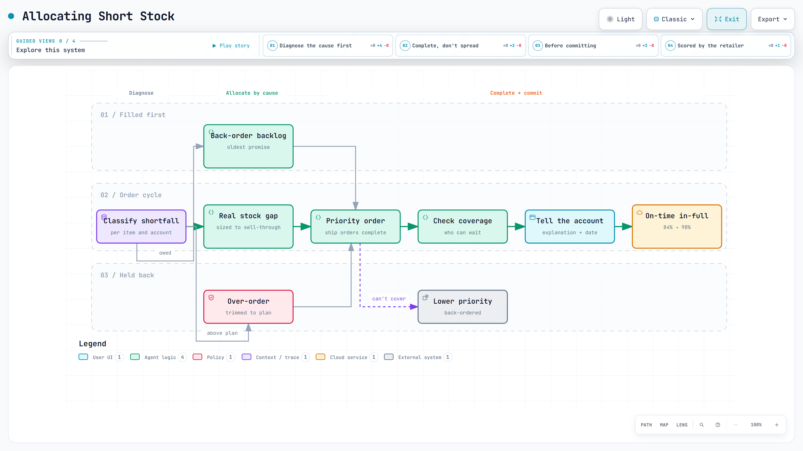

# Allocation when supply is short

When stock runs short, someone decides who gets what, and every choice moves a service score somewhere else. I have managed that call since the third quarter of 2025 across 20+ retail accounts in the US, Canada and Europe. On the retailer that scores us in the most detail, on-time in-full went from 84% to 98% within six months and late and short penalties fell 31% year over year through the first quarter. The method was to diagnose the cause of each shortfall and complete orders in priority order instead of spreading short stock thin, and the same approach took a second major retailer's fill rate from the mid-80s to the high-90s.

<a href="../diagrams/allocation.html"><picture><source media="(prefers-color-scheme: dark)" srcset="../images/diagrams/allocation-dark.png"></picture></a>

Interactive diagram: [open it](../diagrams/allocation.html) for guided views, route tracing and search (one self-contained HTML file).

## The problem

A shortfall looks the same from the warehouse: orders exceed what is on hand. It is not the same problem underneath, and the three causes need different answers.

- **A back-order backlog.** We already owe this account units from earlier weeks. New stock that goes elsewhere makes an old promise older.
- **A real stock gap.** Store or distribution-centre inventory has drained; the account is ordering because its shelves are empty. Shorting it again turns a soft problem into lost sales.
- **An over-order.** The order arrived well above what we planned and what the account's own sell-through supports. Filling it in full moves stock onto a shelf that will not move it, and away from an account that would.

Treating all three the same way is how a planner ends up with a healthy-looking total and two unhappy accounts.

## Constraints

- Allocation decisions happen inside the order cycle, not at leisure: purchase orders arrive on the retailer's schedule, and shipping windows are short.
- Stock sits in several plants and does not move between them quickly.
- Retailers score us, and they score each purchase order as a whole. An order that arrives with 99 of 100 units counts the same as one that never arrived, so a partial fill earns nothing on the scorecard.
- Some accounts share the same regional stock pool, so an allocation decision for one is an allocation decision for the others — including one that had no forecast of its own ([that case is here](shared-stock-pool.md)).

## What I did

1. **Classified the shortfall before allocating.** For each item and account: open back-orders, current store and DC stock position, recent sell-through, and the order against the plan. That is enough to say which of the three causes is in play.
2. **Allocated by cause.** Back-order backlog first, because it is the oldest promise. Then genuine stock gaps, sized to the sell-through that will actually move. Over-orders trimmed to plan, with the reason written down, rather than filled and regretted.
3. **Completed orders in priority order instead of shorting everyone a little.** When stock could not cover every order, lower-priority orders were back-ordered and the rest shipped complete. I set the priority by the retailer's size, the order's volume, the item's sales and how fast it sells. Because the scorecard counts a partial order as a miss, splitting short stock evenly would have failed every order at once.
4. **Checked coverage before committing.** [Days of coverage](shipping-route-automation.md) says how long each account can wait, which decides who can be filled later without a stockout instead of now.
5. **Told the account early.** A short shipment that arrives with an explanation and a date is a different conversation from one that arrives alone.

## Result

- **On-time in-full rose from 84% to 98% within six months,** on the retailer's own vendor scorecard — a number the customer calculates, not us. CVS was the hardest account, and it is the one that scores us in enough detail to show.
- **Late and short penalties on that scorecard fell 31% year over year through the first quarter.**
- **Unit fill rate was already about 99%.** The gain did not come from holding more stock; it came from which orders the short stock went to.
- **The same approach took a second major retailer's fill rate from the mid-80s to the high-90s, and it has held there for eight months,** on that retailer's own report card. The point of the second result is that the first was not specific to one account.

## Limitations

The on-time-in-full figure is one retailer's scorecard and the fill-rate result is a second retailer's; neither is a total across every account. Most accounts do not score us this closely, so for them there is no comparable before-and-after. And a score that improves across an account can still hide a single item that took every short shipment; the per-item view matters more than the total.

Fill rate on its own is not a clean scoreboard either: you can buy a better one by holding more inventory, which is why it belongs next to [excess and aging stock](inventory-health-reporting.md) rather than on its own.
