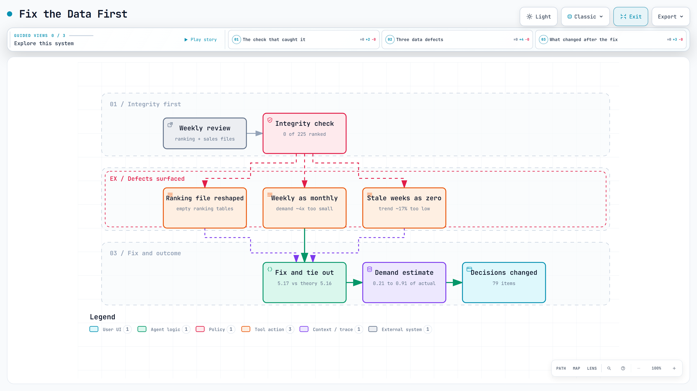

# Fix the data before you judge the item

A weekly review at one account looked normal until one integrity check failed. Three data defects were feeding it. After fixing them, our demand estimate went from 0.21 of actual sell-through to 0.91, and 79 items got a different decision.

<a href="../diagrams/data-integrity.html"><picture><source media="(prefers-color-scheme: dark)" srcset="../images/diagrams/data-integrity-dark.png"></picture></a>

Interactive diagram: [open it](../diagrams/data-integrity.html) for guided views, route tracing and search (one self-contained HTML file).

## The problem

The review was producing confident calls — raise this, cut that — on numbers nobody had checked that week. Every input looked plausible on screen. The failure mode of a system like this is not an error message; it is a decision that is quietly wrong, repeated across hundreds of items.

## The check that caught it

Before reading any item, I check a few things that must be true of the data itself. One of them: every active item should have a syndicated ranking figure. That week the count came back **0 of 225**. A single line, and it said the inputs were wrong before any judgment was made.

## The three defects

**1. A ranking file that changed shape.** The syndicated report arrived with a different panel layout for two accounts, and the parser did not recognise it. Those accounts silently produced empty ranking tables, which is why the check read zero.

**2. Weekly sales read as monthly.** If a week's first row happened to land on the first of the month, the parser treated the file as monthly data. The week's sell-through was then divided across the month instead of counted once, so demand came out roughly four times too small.

**3. Stale weeks averaged in as zeros.** Weeks where the retailer had not yet posted data were being included in averages as zero rather than skipped, dragging the four-week trend down by about 17%.

Each one is small. Together they made the system read a healthy account as a collapsing one.

## What changed after the fix

- **Demand estimate against actual sell-through: 0.21 → 0.91.** The estimate had been reading about a fifth of real demand.
- **79 items changed decision.** Cuts that would have been made on false weakness stopped being made.
- The two correction factors multiplied out to 5.17, against a theoretical 5.16 — they tied out, which is how I knew the fix was the right size rather than a lucky patch.
- The other data path, the one that had been correct, came through unchanged: no side effects.
- Total forecast moved **−0.2%**. Almost nothing in aggregate, and almost everything at the item level. That gap is the whole point.

## What I changed in how I work

- **Integrity first, judgment second.** The review now starts with checks that must be true of the inputs, not with the first flagged item. A failed check stops the run.
- **A parser that changes shape must fail loudly.** Silent empty tables are worse than a crash, because a crash gets fixed that morning.
- **Never average a week the retailer has not posted.** Missing is not zero. The same rule applies to the current month, which is always incomplete.
- **Tie the fix out.** A correction with no independent check is a guess. Two routes to the same number is the cheapest verification there is.

## Limitations

This was one account in one week. The checks now run everywhere, but I cannot claim the same size of error elsewhere — the point is that nobody knew this one was there either. And integrity checks only cover the failures I have already imagined; the next defect will be a different shape.
