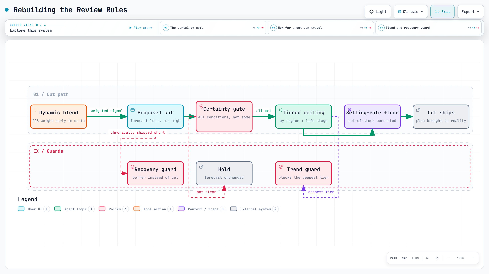

# Rebuilding the review rules

After a year of running the weekly review, the rules had accumulated exceptions faster than evidence. I rebuilt the cut rules around one question: is this cut certain? A cut now has to meet every condition, or the item holds.

<a href="../diagrams/review-rules-overhaul.html"><picture><source media="(prefers-color-scheme: dark)" srcset="../images/diagrams/review-rules-overhaul-dark.png"></picture></a>

Interactive diagram: [open it](../diagrams/review-rules-overhaul.html) for guided views, route tracing and search (one self-contained HTML file).

## The problem

The rule engine decides four things for every item: raise, lower, hold, or leave alone. Most of the damage comes from cuts. An item cut on a soft signal goes short on shelf, and a shelf takes months to recover.

Two failure modes had crept in:

- **Cuts that were too easy.** A single weak window could pull a forecast down, even when the item was chronically shipped short. In backtest, most of the items the rules flagged for a cut were already being under-forecast.
- **Cuts that were too blunt.** One cap applied to items in different stages of life. A phasing-out item and a stable one got the same treatment, so one of them was always wrong.

## Constraints

- The rules are read by people, not only by code. They live in plain-language documents, because planners in other divisions inherit them and adjust them without rebuilding anything.
- Any change has to survive the same gate as any other change: unit, backtest, regression, shadow ([how I work](../how-i-work.md)).
- The engine runs against real weeks. A change that is right on average and wrong on a live account is not shippable.

## What I changed

**A certainty gate on cuts.** A cut now requires every one of these: store in-stock at a healthy level, sell-through not rising, the forecast genuinely above the rate the item is selling at, and no sign that the item is simply working through an initial shipment. If the case is not clear, the answer is hold.

**A floor at the selling rate.** Even when a cut is right, the final forecast is not allowed to fall below what the item is actually selling, corrected for the weeks it was out of stock.

**Tiered ceilings instead of one cap.** How far a cut can travel now depends on the region and where the item is in its life, with a trend guard that blocks the deepest tier when the recent trend does not support it.

**A recovery guard.** Items chronically shipped short (where we are the constraint, not demand) are protected from further cuts and get a buffer instead.

**A dynamic blend.** Early in a month, shipments say less than sell-through does, so the weight shifts toward point-of-sale and back as the month fills in.

**The shape of it, on synthetic data.** [How one item is decided](../diagrams/review-decision.html) walks the clean-room version of this order of checks: raise and cut on separate paths, and every flagged item argued against before it ships. The clean-room rules are simpler than production and every number in them is illustrative; the asymmetry is the part that carries over.

## What the tests said

- **Backtest at one account:** most items the old rules cut were already under-forecast, and the new rules stopped most of those cuts. The sample was small.
- **Regression**: the change moved exactly the rows it was meant to move, and nothing else.
- **Re-validated across six domestic accounts** before it shipped, not one.
- A later round of fixes added the current-month rule: the current month is never treated as complete, and a change to it carries into later months with a damping factor rather than as a flat percentage.

## Limitations

The backtest comes from a small sample at a single account. It is directionally right and it survived the regression and the wider re-validation, but it is not a precise measure of anything. So the claim here is the rule change itself, with no percentage attached.
