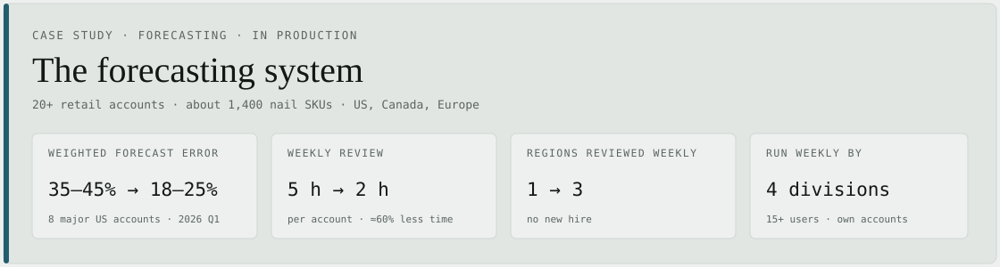
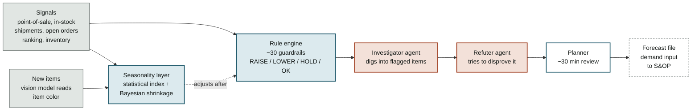
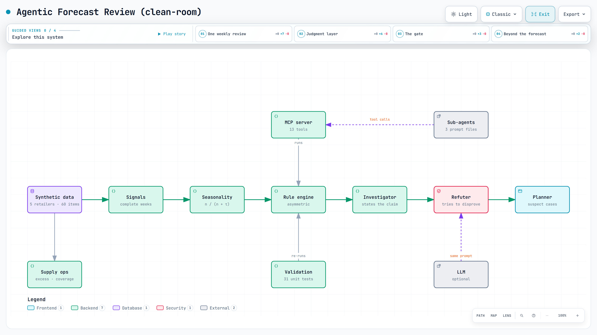

# The forecasting system

<picture><source media="(prefers-color-scheme: dark)" srcset="../images/work/forecasting-system-dark.svg"></picture>

**Two parts of this have their own pages: [what the weekly job became](exception-based-planning.md) — how the work is organised now — and [handing it to teams that are not mine](handover-to-other-teams.md).**

[My role](#my-role) · [The problem](#the-problem) · [How it is built](#how-it-is-built) · [Design decisions](#design-decisions) · [One item's trace](#one-items-trace) · [Results](#results) · [Limitations](#limitations)

**In backtests on our eight major domestic accounts, weighted forecast error fell from 35–45% to 18–25%. The weekly review went from about 5 hours to 2 per account, and coverage from one region to three, filling a capacity gap without a new hire.** Since the system went live in January 2026, the share of sales orders backordered for planning reasons is down 36%. Store in-stock held above 94% every week from July to October 2026, against a 90% low over the same months of 2025. An agentic AI planning system for 20+ retail accounts across the US, Canada and Europe, about 1,400 nail SKUs. It placed third of 24 teams in the company-wide AI Awards 2026.

## My role

I co-built the system with one colleague. My part was the agent architecture, the business rules and guardrails, and the data integration: I coded the rules that screen every SKU, set up the LLM verifier that challenges each flag, and built the MCP server the agents run on, with 30+ tools and 11 AI agents on our SAP and Snowflake data. That server expanded planning capacity without added headcount. Both of us validated the rules against real accounts, and our manager set the direction and reviewed the business case. I also led the rollout to the other divisions and ran the training sessions for each team.

## The problem

Before the system, forecasts came from a paid statistical platform, spreadsheets and judgment. Point-of-sale, shipments and forecasts lived in different places, and the same item could get a different call depending on who reviewed it.

A weekly review took about 5 hours per account, more than the team could give 20-plus accounts every week. So only the US got a weekly look; Canada and Europe were reviewed monthly or not at all. When a forecast was wrong, it showed up later as one of two costs: an empty shelf on a popular new item, or cash sitting in stock of a shade that had stopped selling.

## How it is built



<sub>Blue: where the call is made · rust: the two agents that argue about it · dashed: what it feeds</sub>

**Seasonality.** A statistical index from point-of-sale, normalized by store count. Each item's own seasonal curve is blended with its segment's curve by Bayesian shrinkage: the more months of history an item has, the more weight its own curve gets. An item with four months of sales borrows most of its shape from its segment. An item with four years of sales does not.

**Seasonality stays out of the decision.** The decision logic does not read the seasonal index. Seasonality adjusts a decision after it is made, and guards stop the extreme cases. The reason is measured: at the item-month level, seasonal curves line up with actual sales only weakly (correlations around 0.14 to 0.33). A weak signal inside the decision would move decisions it has no business moving.

**New items.** A new item has no history at all. A vision model reads each item's color from product images, and a fixed color-to-month table turns that into a starting seasonal curve until real sales arrive. A later check against point-of-sale found the color-to-season link weak, so color is used only as that starting point and never to reshape an existing item's curve.

**The rule engine.** It makes the call on every item, with about thirty guardrails. The two ways to be wrong do not cost the same, so cutting and raising follow different rules:

- **Cutting** risks an empty shelf. Cuts are capped. If the item's in-stock rate at stores is already low, cutting is switched off and the item gets a buffer instead.
- **Raising** risks trapped cash. A raise needs a second, independent signal. Shipments going up is not enough on its own; that returns HOLD.
- **The numbers, as of September 2026:** cuts are capped at −25% to −40%, depending on region and where the item is in its life. Raises are capped at +25%, or +35% in the UK, where chronic over-shipping is common. Below 90% store in-stock, there is no cut; the item gets a +10% buffer instead.

**The agents.** An LLM-based investigator looks at every flagged item across all the signals. A separate refuter gets one instruction: disprove what the investigator concluded. A single agent asked to find problems will confirm whatever it finds, so checking and arguing are different roles.

**The planner.** The planner reviews what survives, in about thirty minutes, and makes the final call.

## Design decisions

1. **Estimates and safety are separate.** The demand estimate comes from sell-through, shipments and the seasonal index. Caps, buffers and seasonal guards are rules, so a bad estimate cannot become a bad order on its own.
2. **Shipments below plan do not mean demand fell.** They can also mean we could not supply. Sell-through is the demand signal.
3. **Nothing goes live without four checks:** unit, backtest, regression, shadow. Each answers a different question (see [how I work](../how-i-work.md)).
4. **Domain rules are written in plain-language documents, not buried in code.** That is why other divisions could take the system over in days instead of rebuilding it.

## One item's trace

An illustrative trace, in the format the system writes:

```
ACCOUNT   national drugstore chain · 78 items in scope
FLAG      shipments −59% vs 4-week average
CHECK     sell-through, last 4 weeks ......  flat
CHECK     store-level in-stock ...........  71%  ← below floor
CHECK     open orders ....................  2 pending
REFUTE    "demand fell" — not supported. Flat sell-through with
          low in-stock indicates a supply gap, not a demand drop.
VERDICT   HOLD · forecast unchanged · buffer applied
```

Most of what the system produces is a non-event like this one, which is the point.

## Results

| Result | Before → after | Kind |
|---|---|---|
| **Weighted forecast error** | **35–45% → 18–25%** | measured |
| **Weekly review** | **5 h → 2 h** per account | measured |
| **Coverage** | **1 region → 3**, weekly | measured |
| **Software cost** | **−$26,517/yr** net, 88% lower | realized |
| **Planning-related backorder rate** | **−36%**, Q2–Q3 YoY | measured, not all attributable |
| **Store in-stock** | **above 94%** every week, July–October 2026 | measured, not all attributable |
| **Adoption** | **4 divisions**, 15+ users, weekly | in use |

<details markdown="1">
<summary><b>How each number was measured</b></summary>

- **Weighted forecast error** — WMAPE, volume-weighted by shipment units · Σ\|actual − forecast\| ÷ Σ\|actual\| · measured on our eight major domestic accounts, by retailer · existing items (spring launches excluded, fall resets included) · 2026 Q1, validated on a six-month rolling backtest · the range is the spread across retailers
- **Weekly review** — ≈60% less time per account review · ≈3,100 hrs/yr of capacity across the team (≈1.5 FTE): 3 hours a week × 20 accounts × 52 weeks · an estimate of what a weekly review of every account would have cost, since Canada and Europe were reviewed monthly or skipped before
- **Coverage** — the US, Canada and Europe · review throughput ≈4× (monthly → weekly)
- **Software cost** — a third-party planning platform's $30,117/yr license, now retired, less $3,600/yr for the in-house system, 88% lower · a realized saving
- **Planning backorders** — backordered order value tagged with planning or procurement reason codes, as a share of all sales-order value · the second and third quarters of 2026 against the same quarters of 2025 · the system went live in January 2026, and with a three-to-four-month lead time the first quarter still ran on orders placed before it · procurement codes sit in the same measure, so I do not claim all of the drop
- **Store in-stock** — share of stores with the item on the shelf, from each retailer's weekly point-of-sale feed · seven major accounts, nail items, each account's weekly figure averaged equally · above 94% in every week from July to October 2026; over the same months of 2025 it dipped to 90% · 94% is this year's floor and 90% last year's low, so this is not an average-to-average gain · retailers run their own store replenishment, so I do not claim all of it · shipments ran at about 1.08 times point-of-sale in both years, so it was not bought with extra stock
- **Adoption** — nail, lash, cosmetics and appliances · 15+ purchasing and supply chain users run it weekly on their own accounts · each team was set up on its own data, trained, and now runs it without me

</details>

A note on the error metric: this is the standard form, total absolute error divided by total actual, so ordering too much is not rewarded. Items selling fewer than five units a month, new launches still ramping, months where we could not supply, and one-time bulk orders are scored separately rather than mixed into the headline figure.

## Constraints I had to work inside

- **No new platform budget and no engineering team.** Whatever we built had to run on the tools we already had, and be maintainable by a planner.
- **The ERP stays the system of record.** The system proposes changes to a forecast; it does not write anything nobody reviewed.
- **The two errors are not symmetric.** An empty shelf costs months of recovery; excess stock costs cash. The rules had to treat them differently.
- **Other people inherit it.** The rules live in plain-language documents rather than in code, because the other divisions took the system over and adjusted it themselves.

## What I chose not to do

- **No black-box model on top.** A forecast a planner cannot interrogate gets overridden into uselessness.
- **No fully automatic changes.** Every change the system proposes is reviewable, and the ones it is least sure about are handed to a planner rather than applied.
- **No seasonality inside the decision.** Seasonal curves correlate with actual item-month sales only weakly, so seasonality adjusts a decision after it is made instead of driving it ([why](forecast-automation-engine.md)).

## Run a version of it

The production system stays private. [A clean-room version](https://github.com/yss2333/Jay-supply-chain-ai-portfolio/tree/main/system) rebuilds the same design from scratch on synthetic data: the asymmetric rules, retailer scouts, the refuter and the investigator as Claude Code sub-agents over an MCP tool server, and the four validation stages as commands. Six planted scenarios (a supply gap, a promotion in the baseline, a bulk order, and others) show each rule doing its job, and the rules on this page are its unit tests.

[](../diagrams/system-map.html)

<sub>The clean-room system as an interactive diagram: [open it](../diagrams/system-map.html) for guided views, route tracing and search.</sub>

## Limitations

- The accuracy figures are a range because they are a range: the spread across retailers, not a single number. Accounts with short histories or thin distribution sit at the wrong end of it.
- The measured window is 2026 Q1 with a six-month rolling backtest, on eight major domestic accounts. It is not a multi-year track record, and it does not cover every account the system reviews.
- The backorder figure compares the same months of two years. The system went live in between, but the measure also counts procurement problems, so it shows the direction, not how much the system alone did.
- The in-stock figure is the retailers' own shelf measure, and they run store replenishment. It shows the accuracy gain did not come from ordering less; it does not show that the system alone kept the shelves full.
- A rule engine encodes the exceptions someone has already seen. The next failure will be one nobody wrote a rule for, which is why the [integrity checks](data-integrity-review.md) and the [validation gate](../how-i-work.md) matter more than the rules do.

## What the output feeds

The output is the forecast file, and the weekly review is the demand input to S&OP: its calls reach the review meeting with their reasons attached, not just the numbers.
