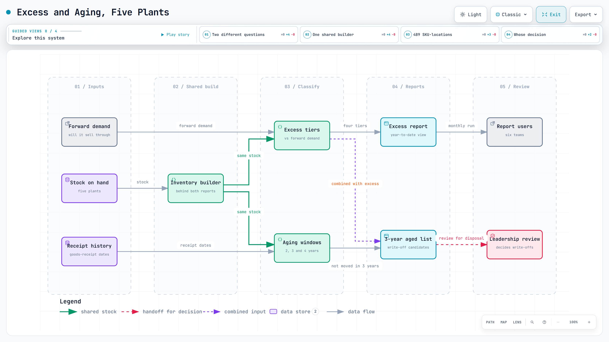

# Excess and aging inventory, five plants

Excess and obsolete (E&O) reporting for five plants in the US, Canada and Europe: two reports that answer two different questions and are easy to mix up.

| | Excess | Aging |
|---|---|---|
| Question | What will not sell through in time? | What has been sitting too long? |
| Based on | stock vs forward demand | goods-receipt history |
| Output | four tiers: normal, surplus, excess, over-excess | stock older than 2, 3 and 4 years (write-off candidates) |

<a href="../diagrams/inventory-health.html"><picture><source media="(prefers-color-scheme: dark)" srcset="../images/diagrams/inventory-health-dark.png"></picture></a>

Interactive diagram: [open it](../diagrams/inventory-health.html) for guided views, route tracing and search (one self-contained HTML file).

## What I built

- **Excess across five plants.** Stock against forward demand, classified into four tiers, with product images so reviewers recognise items at a glance.
- **A year-to-date view that keeps up by itself.** The window runs from January through the current month and rolls forward automatically. Each run compares itself with the previous one and explains what changed.
- **Aging from receipt history,** over 2, 3 and 4-year windows, combined with excess and returns.
- **One shared inventory builder behind both reports,** so their totals tie out by construction instead of by hope.
- **Tiers agreed with the people who use them, and an aging standard that did not exist before.** The company already had a Power BI inventory report. I co-defined the excess tiers and implemented them in code, so both reports match the numbers management already reads. The 3-year aging standard was new: stock that had not moved in three years had never been counted as a list.

## Rules that came out of using it

- Stock with a confirmed order is never excess.
- A large one-day swing gets tied to the goods-issue record before anyone explains it.
- Dollars and item counts come first. The excess *share* of stock rises whenever healthy stock ships, even while excess dollars fall, so the share comes second.

## Result

- **489 SKU-locations of aged excess stock on the first three-year aged list.** An item counts once for each plant that holds it. The part of excess stock older than three years became a named list management could review for liquidation, instead of a share hidden inside total inventory. What was then written off, and when, was their decision.
- **By our estimate, from about 6 hours to 30 minutes per report.** Before, receipt history and forward demand were pulled by hand and tiered in a spreadsheet.
- **Used by six teams in four departments,** including finance, inventory management and purchasing.

## Run it

A clean-room version on synthetic data: [notebook 03](https://github.com/yss2333/jay-supply-chain-ai-portfolio/blob/main/system/notebooks/03_excess_and_aging.ipynb) — four excess tiers and 3-year aging, with a write-off list that keeps over-buys off it.
