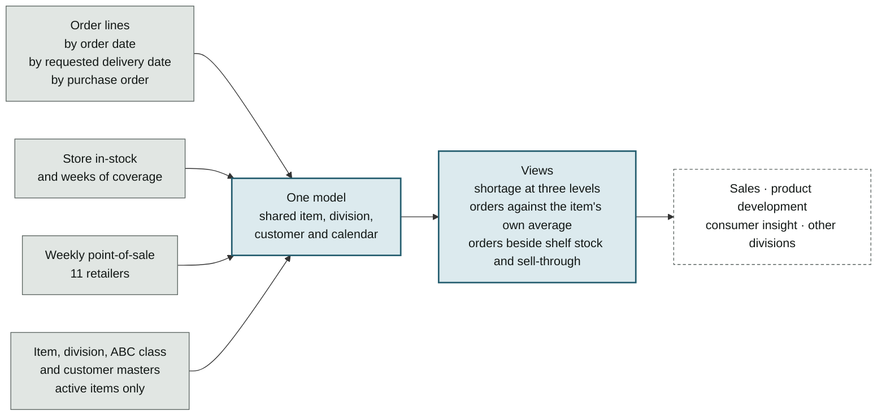

# Order trend and in-stock dashboard

**One self-service Power BI model that puts 600K+ order lines from all 130 customers alongside weekly store in-stock and point-of-sale, refreshed daily.** It anchors order-exception reviews with retailers (CPFR) and, for two years now, sell-through tracking across sales, product development, consumer insight and other product divisions.

## My role

I built it and have kept extending it since May 2024: the data pipeline, the model, the measures and the report. Each addition answered a question someone kept asking.

## The problem

The same questions came up every week. Is this account ordering less, or are we shipping less? Is this back-order new, or has it been open for a month? Are stores running low, or are they simply ordering less? Each answer meant pulling order lines by hand. History from before a system migration sat in separate files, so a trend broke at the migration date. And order data on its own could not say whether a drop meant falling demand or full shelves.

## How it is built

Grey: data feeds · blue: the model and what it computes · dashed: who reads it

Six feeds meet in one model: 17 tables and 38 relationships, so that any view can be cut by item, division, customer or week without a second report.

| Feed | What it contributes |
|---|---|
| **Orders by order date** | Demand: what customers asked for, and when they asked |
| **Orders by requested delivery date** | Service: what was due, and what we shipped against it |
| **Orders by purchase order** | Which single order came up short |
| **Store in-stock and coverage** | How full the shelves are, and how many weeks that stock lasts |
| **Weekly point-of-sale, 11 retailers** | What is actually selling in stores |
| **Item, division, ABC and customer masters** | Active items only, grouped by division and class, across product divisions |

## What it answers

| The question | Where the answer comes from |
|---|---|
| Is this account ordering less, or are we shipping less? | The same orders by order date and by requested delivery date |
| Is this back-order new, or a month old? | Shortage rate by delivery date, down to the single purchase order |
| Did stores stop selling, or do they just have stock? | Orders beside store in-stock, weeks of coverage and point-of-sale |
| Is this week unusual for this item? | Last week's and last month's orders against the item's own average |

## What I built

- **One order history, 2022 to today.** A Python pipeline pulls current order lines from the data warehouse and joins them to the pre-migration history, including a plant that was retired in the migration. Where the two overlap on the same customer, date and item, the newer record wins. A trend no longer breaks at the migration date.
- **Two dates for the same orders.** By order date, the report shows demand. By requested delivery date, it shows service. A back-order looks different in each, and planners and sales ask different questions of it.
- **Shortage at three levels.** Order, confirmed, delivered and short quantities, with their value and a shortage rate by order date, by requested delivery date and by purchase order.
- **In-stock and sell-through next to orders.** Latest-week store in-stock, weeks of coverage, weekly point-of-sale and ABC class for each item. An order drop can then be read against what stores still hold and what they are still selling: a store with full shelves ordering less is not a lost customer.
- **Only live items.** Data is filtered through the item master to active items, across product divisions, so discontinued lines do not dilute the trend.

## How it grew

| When | What was added |
|---|---|
| 2024 | Orders, store in-stock, coverage and weekly point-of-sale in one model; last week's orders against each item's average |
| October 2024 | Shortage rate |
| December 2024 | Purchase-order level |
| February 2025 | Requested-delivery-date view |
| 2025 | Daily automatic refresh |
| November 2025 | Monthly comparison |
| March 2026 | Active-item filter from the item master |

Dated rows come from the model's own change history, which records later edits rather than first builds.

## Two reports beside it

Two more Power BI reports read the same order, shipment and point-of-sale data ([from SAP to Snowflake](data-platform.md)):

- **Forecast variance.** Shipped units plus open orders divided by forecast, per item and account, on a three-month rolling window that leaves out the incomplete current month. Anything outside 75–105% is flagged, and the flags set the queue for the monthly forecast review. The denominator is the plan, so it answers "how much of the plan did we ship", not statistical error. The forecasting system's accuracy gain was measured separately, on a six-month rolling backtest ([how](forecast-accuracy-measurement.md)).
- **A trend report per retailer,** 15 or more accounts, cut from the same backbone, so an account manager opens one file and sees only their account.

One case shows what the three are for together. Store in-stock fell at a national mass retailer, and the first read was that the retailer was ordering less. Orders compared over equal-length windows said otherwise: we had short-shipped 9–22% of what was ordered on the low-stock items ([dashboards for vendors, retailers and the warehouse](dashboards.md)). Finding where a back-order came from later moved into code, which sorts each shortage into one of eight causes and flags any item short more than half its order.

## Result

- **Shared across departments beyond planning.** Sales, product development, consumer insight and other product divisions use it when they need order or sell-through trends.
- **Trends at a glance instead of by hand.** Order, shortage and point-of-sale trends that used to mean pulling order lines for each question are one filter away.
- **An order drop can be told apart from a demand drop.** Orders sit beside shelf stock and sell-through, so falling orders from full shelves read as a stocking pattern, not a lost customer.
- **Kept current for two years.** It grew one view at a time as new questions came up.

## Limitations

- Usage is not tracked here: the report is shared with teams and opened when they need it, so there is no view count to show.
- It is an import model refreshed from its feeds, so it is as current as its last refresh, which the report shows.
- Point-of-sale covers 11 retailers; accounts without a point-of-sale feed show orders and shortages only.
- The variance report mixes two failures: an over-forecast and a missed shipment both land outside the band, and it cannot separate them. The 75–105% band was set by judgment, never tested against outcomes.
