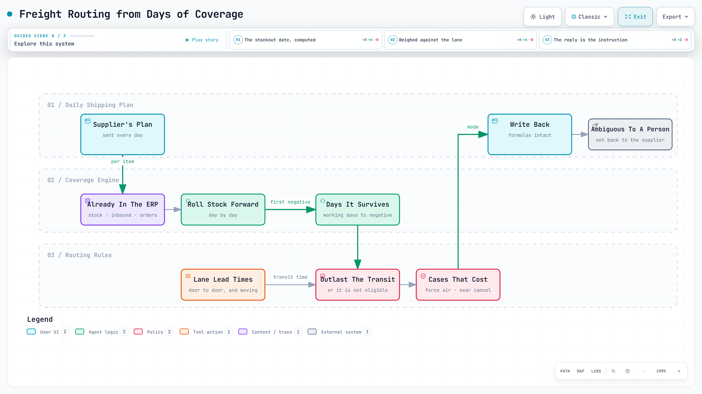

# Freight routing from days of coverage

Our supplier sends a shipping plan every two days. We decide how each item should travel, send it back, and they ship to that answer — so the reply is the instruction. With roughly 120 days from purchase order to receipt, a wrong mode cannot be manufactured away: the only lever left is how it moves.

<a href="../diagrams/shipping-route.html"><picture><source media="(prefers-color-scheme: dark)" srcset="../images/diagrams/shipping-route-dark.png"></picture></a>

Interactive diagram: [open it](../diagrams/shipping-route.html) for guided views, route tracing and search (one self-contained HTML file).

What it comes to is this: every product's freight route is now reviewed on its own conditions — its own stock-out date, its own destination's transit time, its own situation. Nothing stopped being reviewed. The rules do the reviewing, and a person looks at the small share they could not settle.

## The problem

Air costs several times ocean. Ocean that lands late becomes a stockout, and a stockout lands on the retailer's scorecard as a penalty. Cash on one side, service level on the other, decided line by line, on every plan.

Each line was worked out by eye — how much is coming, when it is needed, when the item runs out — against how long each lane takes. The cost was not the time it took. It was that **the same line could get two different answers**: one reviewer read the file and said ocean, another said air. Neither was wrong. The judgment had never been written down, so it lived in each person's head, where it could not be reproduced, questioned or improved.

## What I built

- **The stockout date, computed.** Stock on hand, inbound shipping notifications, firm orders and forecast all sat in the ERP already; nobody had strung them together. Rolled forward day by day, they give the first date projected stock goes negative — and the working days until then are what the item can survive.
- **Weighed against the lane, not against a preference.** Every lane has its own door-to-door time: factory pickup, sailing, port, inland. The rule is one sentence — *use a lane only if stock outlasts its transit* — which is why the thresholds are lead times rather than opinions, and why cover is counted in working days.
- **One rule, set per destination.** The plan covers 1.5K+ SKU-locations in five plants across the US, Canada and Europe, and each threshold follows its lane's transit time rather than one shared default. The two US plants share one value, Canada and Europe share another, and the UK lane, the longest and least predictable, gets an extra week.
- **Rules for the cases that cost money** (below), rather than one formula applied to everything.
- **Built for buyers, not programmers.** The answer is written back into the workbook they already send to the supplier, formulas intact, from a one-click tool that signs in through the company's single sign-on and stores no password.

## The decisions inside the rules

- **Lead times are not constants.** They differ by destination — the UK lane is the longest and least predictable, so it carries an extra week — and they move: vessels reroute around conflict and canal congestion, and duty changes which origin and lane are actually the cheapest landed. So the thresholds are maintained with the buyers rather than set once, and anything ambiguous goes to a person instead of straight back to the supplier.
- **An item that never goes negative takes the cheapest lane by definition.** Plenty of cover is not a reason to hurry.
- **An item with no near-term demand is a launch, not a replenishment,** and is judged on when its demand starts. Read as a stock problem, it gets the wrong answer.
- **Stock arriving is not stock arrived.** If supply is inbound but projected stock still dips below zero before it lands, the item is forced to air. *"More is coming"* is the most expensive wrong assumption in this job.
- **A cancel recommendation beats a route — if it is near.** When the ERP says an inbound receipt should be dropped, that outranks routing; far-dated cancellations are year-end housekeeping and are ignored.
- **Read the worst day of a week, not its average,** and never commit to air on one tight week — look across the horizon first. A dip is not a shortage.
- **Guard against the silent miss.** Building the table only from items with events in the next three weeks quietly drops every item without them. It is built from all items across the horizon instead, and the reason is written in the code.

## Handed over

Built in December 2025, piloted for a month, then released to the purchasing teams of four product divisions. Sixteen buyers run it and answer the supplier from its output. I do not run it.

They run it two or three times a week — on the order of 130 cycles and 39,000 lines a year, of which about 7% come back for a person to decide. The point of that number is not the 93%: it is that a buyer's attention now goes to the lines the rules could not settle, instead of being spread evenly over a plan where most lines were never in question.

This is the same method as [the forecast review](exception-based-planning.md), applied to a different decision — write the judgment down, let the rules settle what they can, and put a person on what they cannot.

It has kept changing since, and the requests come from the people using it: which items are held back for review, how a cancel recommendation is ranked against them. That is the argument for writing a judgment down — a rule in one file can be challenged and changed; a rule in someone's head cannot.

## Did the calls hold?

A route written in a cell is not a shipment. So I went back to the lines whose shipping mode was later confirmed and checked what actually happened.

| What the tool said | Of the lines later confirmed, shipped by air |
|---|---|
| **At risk — air** | **29.2%** |
| Flagged for a buyer to review | 28.0% |
| **Every lane it cleared as cheap enough** | **0.6%** |

Air is roughly **46 times more concentrated** on the lines flagged as at-risk than on the lines cleared for a cheaper lane, and about **80% of routed units move on those cheaper lanes**. Two things follow: air is being spent where the stockout risk actually is, and the calls held after the tool left my hands.

Read the other way round, the same number is a service answer rather than a cost one: **99.4% of the lines sent by a cheaper lane were never rescued by air.** Someone switching a line to air later is the signal that the cheap call was wrong, and that almost never happened. Spending less did not create emergencies.

This is an association, not proof of cause — the confirmations come from the supplier side, and many lines were never confirmed in the files I hold. It is also not an on-time figure: not being rescued is not the same as arriving before the stockout, and I did not measure that.

## What I cannot show

**A freight saving in dollars.** That needs what would have been chosen without the tool, and no record of it exists: the decision was never written down before. Reserving air for genuine risk is the mechanism; I have not priced it, and I would rather say so than publish a number I cannot defend.

## What I would fix

Known and written down rather than discovered later: the supplier-specific thresholds are switched off, so every item uses the default; the tool edits the workbook in place without taking its own backup; a failed run from the desktop shortcut closes its window and takes the log with it; and the thresholds live in several places instead of one configuration block. None of them change a routing decision today, which is why they are on a list rather than in a patch.

## Run it

A clean-room version on synthetic data: [notebook 05](https://github.com/yss2333/jay-supply-chain-ai-portfolio/blob/main/system/notebooks/05_coverage_and_routing.ipynb) — days of coverage rolled forward, the route it implies, and what a stale stock figure changes.
