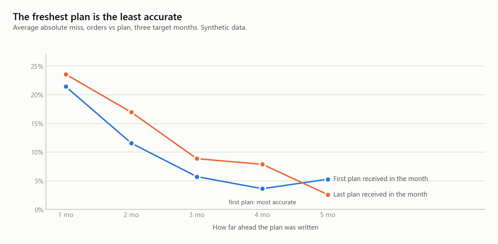

# Agentic forecast review

A weekly retail forecast review run by agents: retailer scouts investigate, a separate refuter tries to disprove what they found, and a rule engine with asymmetric guardrails decides what changes. Runnable, tested, and small enough to read in an afternoon.

> **Clean-room version.** I co-built the production system this is modelled on for my employer; that system and its data stay private. This one was written from scratch for my portfolio, on synthetic data, with illustrative parameters. It contains no code, data, thresholds or customer information from my employer.

```text
> review RETAILER_C

  → retailer-scout reads the flagged items and the weeks behind them
  → forecast-refuter tries to knock each finding down
  → C-05: "sell-through -46%" refuted; one promotion week sits in the baseline
  → final: RAISE C-02 +17% · LOWER C-06 -16% · HOLD C-05
```

---

## The business problem

A demand planner reviews every item at every retailer, every week, and decides: raise the forecast, cut it, hold it, or leave it. The data disagrees with itself. Shipments reflect what we could ship, not what shoppers bought; point-of-sale arrives with promotions and partial weeks mixed in; a new item has no history at all.

Getting it wrong costs money in two ways that are not symmetric. **Cut too far** and shelves go empty, which takes months to recover. **Raise without cause** and cash sits in stock nobody draws from. The judgment is not hard. Making it consistently, thousands of times a week, without falling for a data artifact, is.

## What I built

- **A rule engine with asymmetric guardrails.** Cuts are capped, switched off when store in-stock is low (the item gets a buffer instead), and blocked for new items. A raise needs a second, independent signal; shipments alone return HOLD.
- **An agent layer that argues with itself.** An investigator turns each flag into a claim. A separate refuter's only job is to disprove it. A refuted change does not ship.
- **Claude Code sub-agents over an MCP tool server.** `retailer-scout`, `forecast-refuter` and `item-investigator` reach the data only through thirteen deterministic tools.
- **Four validation stages as code.** Unit tests for every operating rule, a pre-registered backtest against a naive baseline, regression and shadow comparisons.
- **A synthetic data generator** with six planted scenarios, each built to test one rule.
- **The decisions around the forecast** (`supply_ops/`): excess and aging inventory, how far ahead a customer's plan can be trusted, days of coverage for freight routes and supplier urgency, and a leakage gate. One notebook each, one per write-up on the portfolio site.

## Key findings (synthetic run)

- 60 items, 12 flagged, 3 claims refuted, 1 sent to a planner. Most weeks are quiet by design.
- All six planted scenarios land where the rules intend (table below).
- **Without the refuter, a stable item would have been cut 20% because of one promotion week.** That is the shadow comparison, and the reason the refuter is a separate role.
- The pre-registered backtest adopts the seasonal curve for 3 retailers of 5, exactly where seasonality exists, and every forecast beats the naive baseline.

## Notebooks

| Notebook | What it shows |
|---|---|
| [`01_weekly_review.ipynb`](notebooks/01_weekly_review.ipynb) | One review end to end: flagged items, the planted scenarios, traces, what the refuter changed, the revised plan |
| [`02_validation.ipynb`](notebooks/02_validation.ipynb) | Unit tests, the backtest, regression, shadow, and the check that the forecast cannot see the future |
| [`03_excess_and_aging.ipynb`](notebooks/03_excess_and_aging.ipynb) | Four excess tiers, the date rule that invented excess out of confirmed orders, and 3-year aging |
| [`04_supply_plan_horizon.ipynb`](notebooks/04_supply_plan_horizon.ipynb) | Scoring a customer's weekly plan at every horizon: the freshest plan is the least accurate |
| [`05_coverage_and_routing.ipynb`](notebooks/05_coverage_and_routing.ipynb) | Days of coverage driving the freight route and the supplier's urgency, and what a stale stock figure changes |
| [`06_leakage_gate.ipynb`](notebooks/06_leakage_gate.ipynb) | A forecast that looks too good: value added over naive, the within-5% fingerprint, and the own-answer test |


| Item | Scenario | A simple rule would | This review |
|---|---|---|---|
| A-03 | We could not ship; stores kept selling | cut on falling shipments | HOLD with a buffer: supply gap |
| A-07 | Sell-through genuinely falling | cut | LOWER, capped at −20% |
| B-02 | Sell-through and open orders both rising | raise | RAISE +28%, confirmed by two sources |
| B-09 | One large shipment, nothing else changed | raise on shipments | HOLD: one order is not a trend |
| C-05 | A one-week promotion in the comparison window | cut on a −46% "drop" | HOLD: refuted on run-rate |
| D-01 | Nine weeks of history, an optimistic launch plan | cut | HOLD, sent to a planner |

The other flagged items are not planted: they are growing or fading items whose plans were set months ago, which is what a real week looks like.


## Beyond the forecast

Most weeks are spent on the decisions around the forecast. `supply_ops/` rebuilds four of them on their own synthetic data, each with a planted situation to find.


- **Excess and aging** ([notebook 03](notebooks/03_excess_and_aging.ipynb)). Confirmed orders dated last month drop out of a demand window when the month rolls over, and the stock reserved for them turns into "excess". Counting them is the fix; counting every past-due line is the opposite mistake. Aged stock is a separate question with a separate list.
- **Supply-plan horizons** ([notebook 04](notebooks/04_supply_plan_horizon.ipynb)). The customer cuts its plan in the last weeks before a month, and cuts too far, so the freshest plan misses most.
- **Coverage** ([notebook 05](notebooks/05_coverage_and_routing.ipynb)). One number, business days to the next back-order, picks the freight route and tells a supplier how urgently to produce. A stock figure a few hours stale flips the call on a handful of items.
- **Leakage gate** ([notebook 06](notebooks/06_leakage_gate.ipynb)). A feature that quietly contains the answer doubles the value added over naive. The own-answer test catches it: an honest forecast does not move when its own target changes.



## One trace

```text
ITEM      RETAILER_C · C-05 · summer
FLAG      sell-through -46% vs the prior 4 weeks
CHECK     sell-through, last 4 weeks ........   -46%  down
CHECK       same, spike weeks removed .......    -7%  one week dominates the window
CHECK     store-level in-stock ..............    95%
CHECK     shipments, last 4 weeks ...........   -42%  one week dominates the window
CHECK     open orders .......................    -3%  flat
CHECK     history ........................... 104 weeks
RULE      proposed LOWER -20%: sell-through -46% vs the prior window; capped at -20%
REFUTE    "demand fell": REFUTED. one spike week sits in the comparison window; on run-rate, sell-through is -7%
VERDICT   HOLD · forecast unchanged
```

## Validation results

| Stage | Question | Result |
|---|---|---|
| Unit | Does each rule do what it says? | 31 tests pass: low in-stock is never cut, caps hold, a raise needs a second signal, new items are protected, an unfinished week is ignored |
| Backtest | Is it more accurate on weeks it could not see? | Seasonal adopted for A, B, C (+2.4 to +7.6 points vs flat); kept flat for D, E. Value added vs naive +1.3 to +4.5 points |
| Regression | Did a change touch anything it was not meant to? | Protecting new items changed exactly one item, the new one |
| Shadow | What would change if it shipped? | Removing the refuter would cut C-05 by 20% on a promotion spike |
| Leakage | Can the forecast see the future? | Multiplying every sale after the origin by ten leaves the forecast unchanged |

## Metric definitions

| Metric | Definition | Question it answers |
|---|---|---|
| WMAPE | Σ\|forecast − actual\| ÷ Σ actual | How far off, in quantity. Blind to direction |
| Bias | Σ(forecast − actual) ÷ Σ actual | Which way. Positive means over-forecast |
| Value added vs naive | WMAPE of "next week = last week" minus WMAPE of the forecast | Was the method worth it at all |
| Shortfall rate | Share of periods where the forecast came in under actual | The stockout side, which WMAPE cannot see |
| Trend | Mean of the last 4 complete weeks ÷ mean of the 4 before − 1, on deseasonalized sales | Is it moving, independent of the season |

## Design decisions worth reading

- **The seasonal curve cannot see the weeks it is used to judge.** It is built from history that ends before the comparison windows, with spike weeks clipped. My first draft built it from all the history: recent growth was absorbed into "seasonality" and the growing item was never flagged. It is the same principle as preventing leakage in a backtest.
- **Trends are read on deseasonalized sales**, so a seasonal swing cannot pass for a trend.
- **An unfinished week is never read.** The generator adds one on purpose, and a test checks that it is ignored.
- **The refuter argues; it does not check.** Its lenses are fixed and ordered, written in [`prompts/refuter.md`](forecast_review/prompts/refuter.md), and the deterministic version follows the same text.
- **The adoption rule is set before the backtest runs.** It lives in `config.py`, not in the analysis.

More in [ARCHITECTURE.md](ARCHITECTURE.md): the three layers, one item step by step, and how the production system evolved from one pipeline to written rules to a judgment layer.

## Project structure

```
system/
├── README.md
├── ARCHITECTURE.md          three layers, one item step by step, how it evolved
├── CLAUDE.md                instructions Claude Code reads in this folder
├── .mcp.json                starts the tool server for Claude Code
├── .claude/agents/          retailer-scout · forecast-refuter · item-investigator
├── mcp_server.py            thirteen tools over the synthetic data
├── forecast_review/
│   ├── synthetic.py         data generator with six planted scenarios
│   ├── signals.py           complete weeks, deseasonalized trends, spike-free versions
│   ├── seasonality.py       store-normalized index, shrinkage toward the segment
│   ├── rules.py             RAISE / LOWER / HOLD / OK with asymmetric guardrails
│   ├── agents.py            investigator, refuter, optional LLM refuter
│   ├── prompts/refuter.md   the refuter's instructions
│   ├── pipeline.py          one weekly review
│   ├── validation.py        metrics, backtest, regression and shadow comparisons
│   ├── report.py, plots.py  traces, summaries and charts
│   └── config.py            every parameter, illustrative
├── supply_ops/              the decisions around the forecast
│   ├── inventory.py         excess tiers, the past-due order rule, 3-year aging
│   ├── plan_accuracy.py     a customer's plan scored at every horizon
│   ├── coverage.py          days of coverage, freight route, supplier tier
│   ├── leakage.py           an honest and a leaky forecast, and the checks between them
│   └── synthetic.py, plots.py, config.py
├── notebooks/               01 weekly review · 02 validation · 03 excess and aging · 04 plan horizons · 05 coverage · 06 leakage
├── images/                  charts used in this README
└── tests/                   31 tests: the operating rules and the honesty checks
```

## Tech stack

Python 3.10+ · pandas · NumPy · Matplotlib · Jupyter · MCP Python SDK · Claude Code sub-agents · `unittest`

## How to reproduce

```bash
cd system
pip install -r requirements.txt

python -m forecast_review                  # the weekly review, a trace for every flagged item
python -m forecast_review backtest         # pre-registered seasonality backtest
python -m forecast_review regression       # one rule change, identical data
python -m forecast_review shadow           # the rules without the refuter, side by side
python -m unittest discover -s tests -t .  # 31 tests

jupyter lab notebooks/                     # the two notebooks
claude                                     # then ask: "review RETAILER_C"
```

The review also writes `output/review.md`, `output/decisions.csv` and `output/revised_plan.csv`. `claude` picks up `.mcp.json` and `.claude/agents/` from this folder. `--llm` makes the refuter ask a model (needs the `anthropic` package and an `ANTHROPIC_API_KEY`; without them it falls back to the deterministic refuter).

## Known limits

- The data is synthetic: shaped like retail demand, but every number is generated. Results show that the design behaves as intended, not how accurate any real forecast is.
- Signals are simplified: one four-week window at weekly grain, with no inventory position, lead time or order cadence.
- The production system also reads syndicated rankings and uses a vision model for new items. Neither is here.
- The LLM refuter is optional and not exercised by the tests.
- Parameters are illustrative round numbers, not tuned values.
